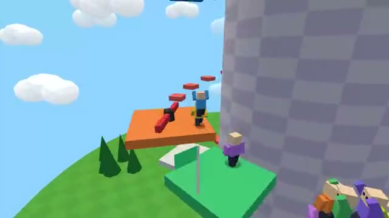

# Obby Tower

Climb an obstacle course with checkpoints. A multiplayer starter game from [Multiplayer Agent](https://multiplayeragent.com): 3D, party, 2–16 players, with bots that fill empty seats.

## How it plays

Jump across moving platforms, lifts and spinning bars to reach the top. Fall and you go back to your last checkpoint. Everyone climbs the same tower at once.

**Controls:** WASD or arrows and Space, or a stick and a Jump button.

## Make it yours in the Game Builder

Open the [Game Builder](https://multiplayeragent.com), choose **Start from a starter game** and pick Obby Tower. It opens as version 1 in your studio, ready to play and publish. Then ask for changes, for example:

- Add lava that rises over time
- Add a stage of spinning bars
- Give a crown to whoever is highest

## Run it yourself

1. Get a free publishable key (`pk_…`) at [multiplayeragent.com](https://multiplayeragent.com).
2. In `index.html`, put it in place of `pk_REPLACE_ME` in the `MP_CONNECT` block.
3. Serve the folder (for example `npx serve`) and open it. The 3D engine loads as a module, which browsers block from a file on disk.

Without a key it still runs, offline against bots.

## How it is built

- One `index.html` plus three.js in `libs/`. The comment at the top of the script maps the code and explains the multiplayer.
- The course is a list of pieces in `CONFIG.course` (jumps, beam, movers, stairs, lifts, spinner, checkpoint, top), laid out bottom to top around the tower. Add, remove or reorder pieces and the bots climb the new course.
- **Saves:** Your furthest checkpoint is kept, so you carry on from it next time.
- **Leaderboard:** The fastest full climbs from the start.
- **Bots:** Bots climb with you, and sometimes fall, until enough people join.
- **Live sync:** Every climber moves for everyone at once, and the moving platforms run on one shared clock.
- `?attract` runs it offline with bots only. The preview video is recorded from it.

## License

MIT. three.js in `libs/` is MIT too (Copyright 2010-2024 three.js authors).
